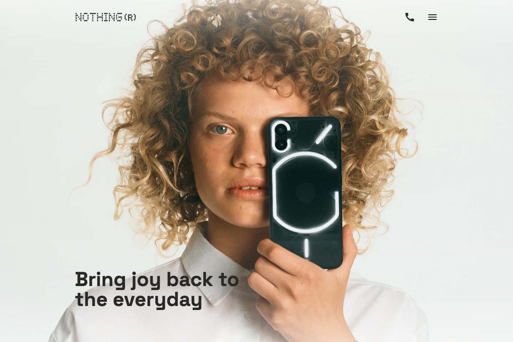
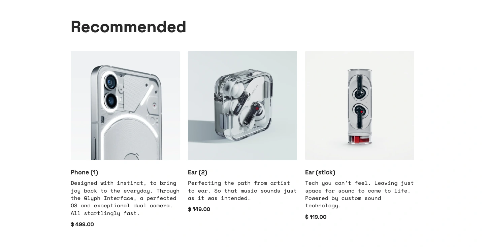
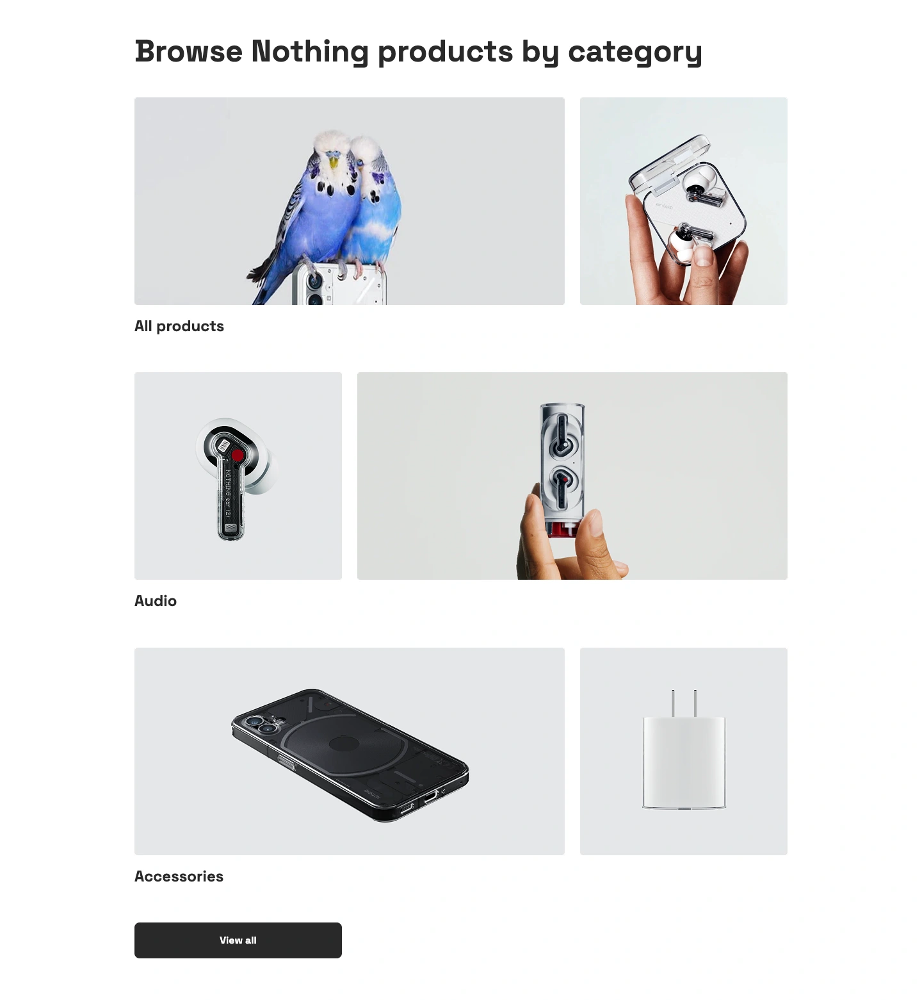
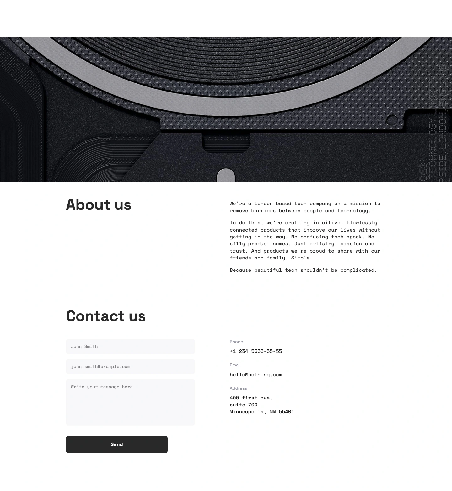
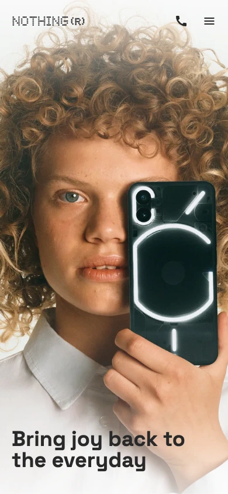
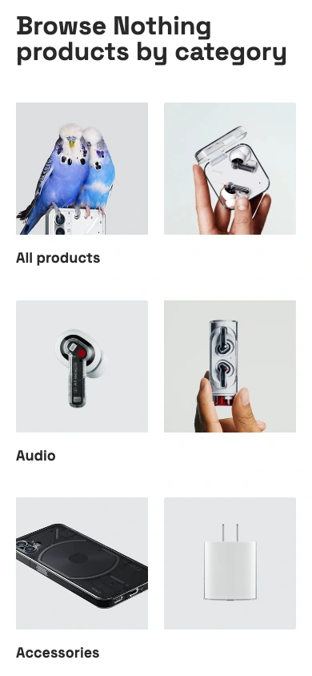
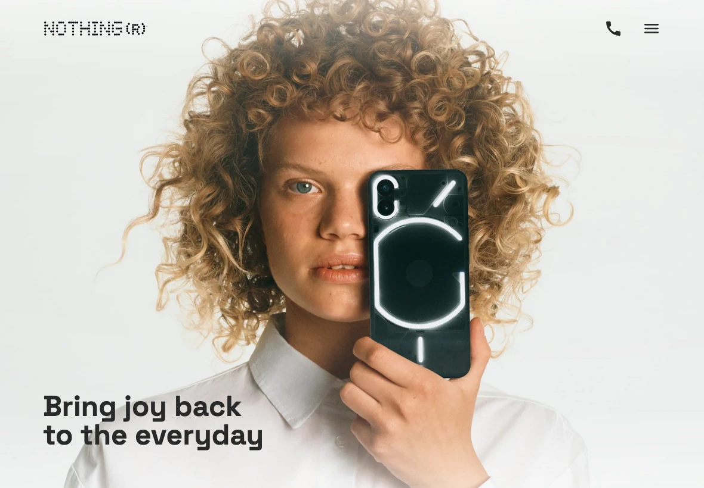
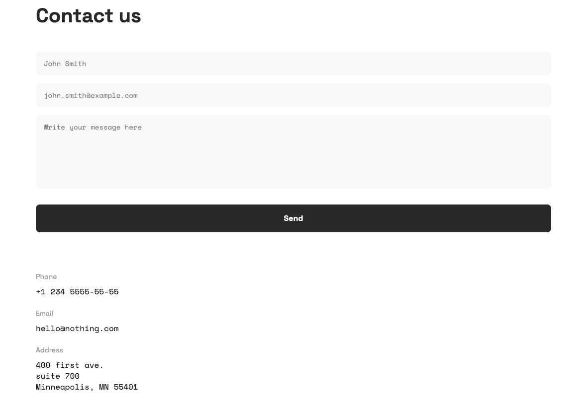

<div align="center">

# Nothing

**Bring joy back to the everyday.**

A responsive product landing page inspired by Nothing's minimalist visual identity.
Built with HTML, SCSS, and vanilla JavaScript.

**[Live Demo](https://ivam2280.github.io/nothing-landing-page/)**

**HTML5 · SCSS · JavaScript · Parcel**

[Overview](#overview) · [Screenshots](#screenshots) · [Getting started](#getting-started) · [GitHub Pages](#github-pages) · [Project structure](#project-structure)

</div>

[](docs/screenshots/desktop-hero.webp)

<p align="center"><sub>Desktop preview · 1440 × 960</sub></p>

## Overview

Nothing is a single-page front-end project that brings together expressive product photography, bold typography, and a restrained monochrome interface. The layout adapts from compact mobile screens to a spacious desktop grid.

The page introduces Phone (1), Ear (2), and Ear (stick), presents product categories, and finishes with a brand introduction and contact section.

### Features

- **Responsive layout** — mobile-first styles with dedicated tablet and desktop breakpoints.
- **Product showcase** — three recommended products with imagery, descriptions, and prices.
- **Category gallery** — asymmetric image grids for All products, Audio, and Accessories.
- **Full-screen navigation** — a CSS-driven menu with animated transitions and scroll locking.
- **Scroll animations** — sections fade and slide into view as the visitor moves down the page.
- **Interactive details** — image hover effects, button states, and smooth anchor scrolling.
- **Contact section** — native form validation, telephone and email links, and a map link.
- **Typography** — Space Grotesk for headings and interface text, paired with Space Mono for descriptions and form fields.

The contact form validates required fields and resets after submission. Message delivery, authentication, and checkout are outside the current implementation.

## Screenshots

Eight screenshots across three device layouts: **4 Desktop · 2 Mobile · 2 Tablet**. Click any image to view it at full size. The desktop hero appears above; the remaining seven captures are below.

Section captures show complete content. Both tablet screenshots use the project's tablet layout at **1180 × 820 px**.

### Desktop

Captured at a viewport width of **1440 px**.

**Recommended products**

[](docs/screenshots/desktop-products.webp)

<table>
  <tr>
    <th width="50%">Product categories</th>
    <th width="50%">About &amp; contact</th>
  </tr>
  <tr>
    <td valign="top">
      <a href="docs/screenshots/desktop-categories.webp">
        
      </a>
    </td>
    <td valign="top">
      <a href="docs/screenshots/desktop-about-contact.webp">
        
      </a>
    </td>
  </tr>
</table>

### Mobile

Both images are **390 × 844 px in portrait orientation**.

<table>
  <tr>
    <th width="50%">Hero</th>
    <th width="50%">Product categories</th>
  </tr>
  <tr>
    <td align="center" valign="top">
      <a href="docs/screenshots/mobile-hero.webp">
        
      </a>
    </td>
    <td align="center" valign="top">
      <a href="docs/screenshots/mobile-categories.webp">
        
      </a>
    </td>
  </tr>
</table>

### Tablet

Both images use a **1180 × 820 px viewport**. At this width, the page uses its six-column tablet grid.

<table>
  <tr>
    <th width="50%">Hero</th>
    <th width="50%">Contact</th>
  </tr>
  <tr>
    <td valign="top">
      <a href="docs/screenshots/tablet-hero.webp">
        
      </a>
    </td>
    <td valign="top">
      <a href="docs/screenshots/tablet-contact.webp">
        
      </a>
    </td>
  </tr>
</table>

### Responsive design

| Layout  | Screen width      | Grid       | Capture viewport          |
| ------- | ----------------- | ---------- | ------------------------- |
| Mobile  | 320–743 px        | 2 columns  | 390 × 844 px · portrait   |
| Tablet  | 744–1259 px       | 6 columns  | 1180 × 820 px             |
| Desktop | 1260 px and above | 12 columns | 1440 × 960 px             |

Breakpoints, colors, typography, and animation timings are defined in [`variables.scss`](src/styles/utils/variables.scss). Shared layout and responsive helpers live in [`mixins.scss`](src/styles/utils/mixins.scss).

## Tech stack

| Technology         | Role                                                            |
| ------------------ | --------------------------------------------------------------- |
| HTML5              | Page structure, product content, and native form validation     |
| SCSS / Sass        | Component styles, variables, reusable mixins, and media queries |
| CSS Grid & Flexbox | Responsive content grids and alignment                          |
| JavaScript         | Scroll reveal animations and contact form behavior              |
| Parcel             | Local development, asset processing, and production builds      |
| Prettier           | Source formatting                                               |

Styles follow the **BEM** naming convention and are organized by page section. The application has no runtime JavaScript dependencies.

## Getting started

### Prerequisites

Use **Node.js 24** and npm. The GitHub Actions workflow uses the same Node.js version.

### Run locally

Clone or download this repository, open its root directory in a terminal, and run:

```bash
npm ci
npm start
```

Open **[localhost:3000](http://localhost:3000)** in your browser. Parcel rebuilds the page as you edit the source files.

### Production build

```bash
npm run build
```

The generated site is written to `dist/`. Relative asset paths are already configured, allowing CSS, JavaScript, and images to load under a repository subdirectory on GitHub Pages.

### GitHub Pages

The included [deployment workflow](.github/workflows/deploy.yml) installs dependencies with `npm ci`, builds the site, and publishes `dist/`.

1. Upload the repository contents, including the hidden `.github/` directory and `.gitignore`.
2. Open **Settings → Pages → Build and deployment → Source** and select **GitHub Actions**.
3. Push to `main` or `master`. Alternatively, use **Actions → Deploy to GitHub Pages → Run workflow**.
4. Wait for the deployment to finish. The deployment job and **Settings → Pages** provide the live site URL.

If uploading through the GitHub website hides the workflow directory, use **Add file → Create new file** and enter `.github/workflows/deploy.yml` as the full filename, then paste the workflow contents.

The `docs/` directory contains README screenshots. Build output, installed dependencies, and caches are generated locally or in CI and are excluded through `.gitignore`.

### Available scripts

| Command          | Description                                               |
| ---------------- | --------------------------------------------------------- |
| `npm start`      | Start the Parcel development server on port 3000          |
| `npm run build`  | Generate an optimized production build in `dist/`         |
| `npm run format` | Format the root HTML and source JavaScript, CSS, and SCSS |

## Project structure

```text
.
├── .github/
│   └── workflows/
│       └── deploy.yml
├── .gitignore
├── .prettierignore
├── index.html
├── src/
│   ├── images/
│   │   ├── categories/
│   │   ├── icons/
│   │   ├── products/
│   │   ├── banner.png
│   │   ├── favicon.png
│   │   ├── header.png
│   │   └── logo.png
│   ├── scripts/
│   │   └── main.js
│   └── styles/
│       ├── blocks/
│       ├── utils/
│       └── main.scss
├── docs/
│   └── screenshots/
├── package.json
├── package-lock.json
├── README.md
└── LICENSE
```

## Author & credits

Developed by **Ivan Tovstukha** as an independent front-end project inspired by Nothing's visual identity. Nothing branding and product imagery are used to present the design concept.

## License

This project is distributed under the **GNU General Public License v3.0**. See [`LICENSE`](LICENSE) for the full text.
